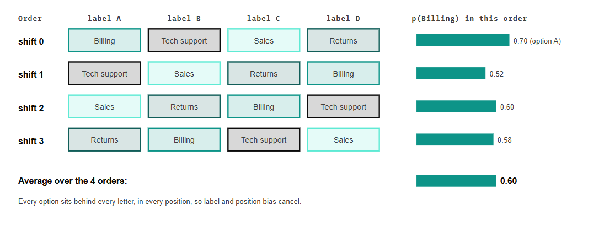
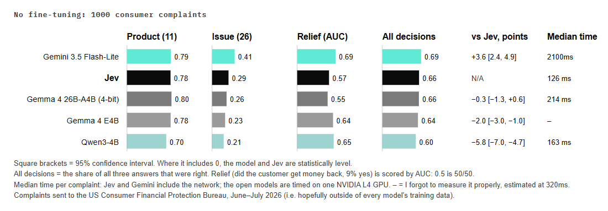
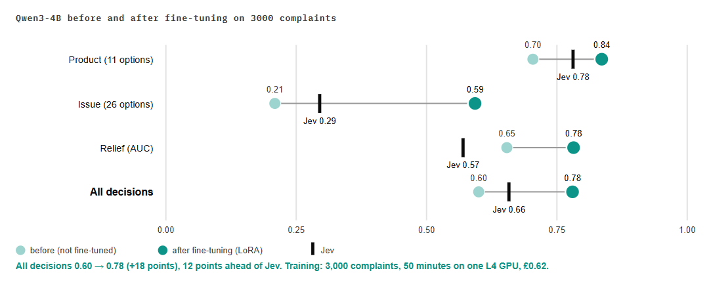
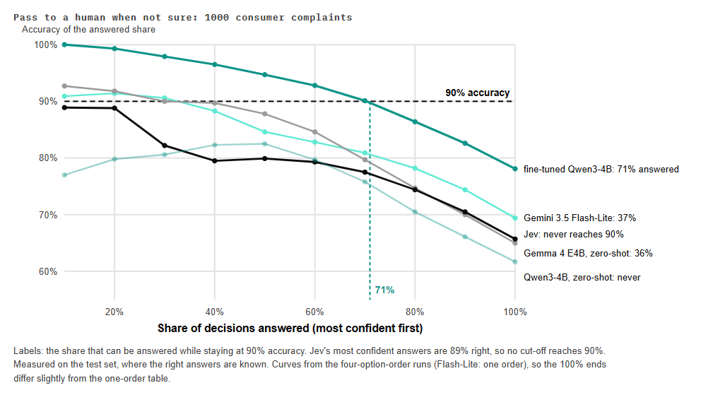
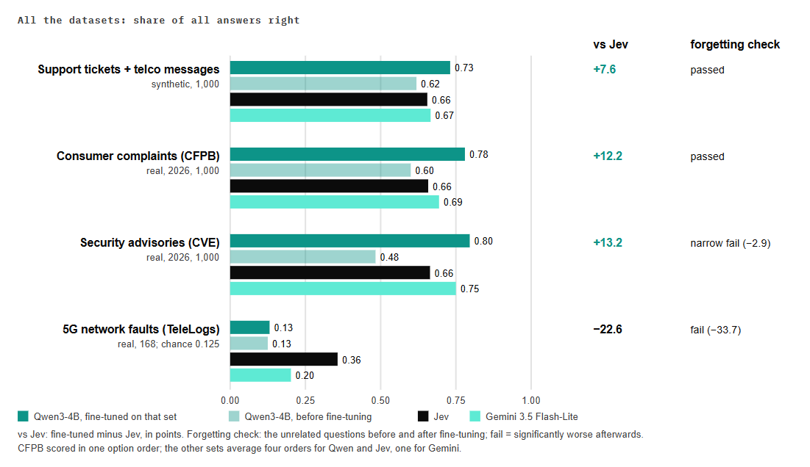
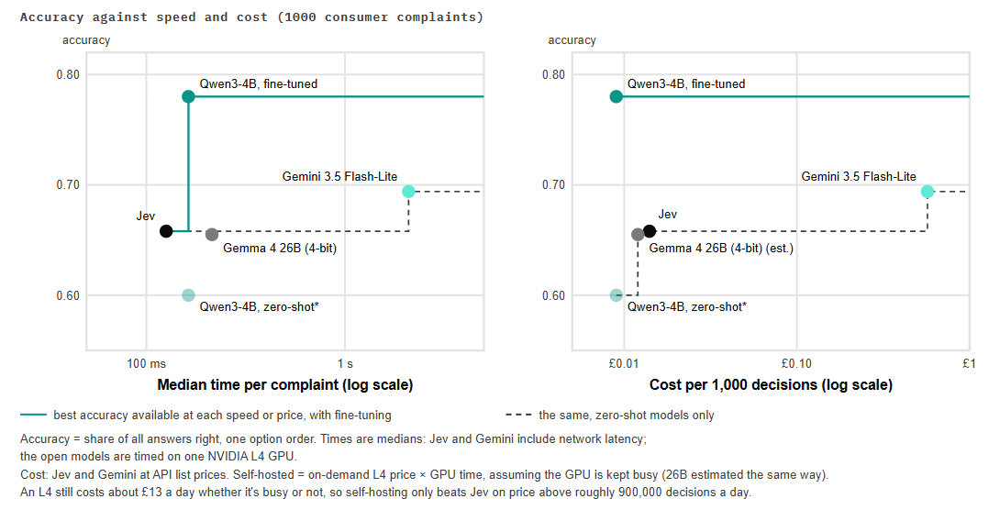
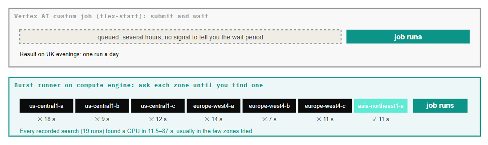

# SnapCall

SnapCall is a home-made "decision model" in the style of TypeSafe's Jev, built on open-weight
models. You give it a piece of text (the *state*, for example a customer complaint) and any
number of questions about it: multiple choice, a score on a scale, or yes/no. It reads the text
once, answers every question in a single forward pass, and returns a probability for each
allowed option, so the answer is always a valid option and the probabilities sum to 1. It
generates no text at all.

With this repo you can:

- run decisions with any supported Hugging Face model, from Python, on a CPU (slowly) or a GPU;
- fine-tune a model for your own decisions with LoRA, and calibrate its probabilities;
- score it against Jev and Gemini on the same test sets;
- run all of that on your own Google Cloud project, one short-lived GPU at a time, from
  GitHub Actions with no keys.

It's an evaluation set-up, not a production service: there's no hardened serving layer.

> **About this README:** it was generated by AI (Claude Code), from the code and the two
> articles below. The articles and the blog are 100% human-written, by me.

## Read the articles

The two articles explain the idea and tell the story of this repo, with all the results. Each
is on my blog and on LinkedIn.

| Article | Blog | LinkedIn |
|---|---|---|
| 1. Jev & Decision Intelligence: what it is, how it works, and what it isn't | [Read on the blog](https://ewanpanter.github.io/2026-10-05/what-is-jev) | [Read on LinkedIn](https://www.linkedin.com/pulse/jev-decision-intelligence-what-how-works-isnt-ewan-panter-f9lse) |
| 2. Building and fine-tuning my own version of Jev on GCP | [Read on the blog](https://ewanpanter.github.io/2026-10-05/building-jev) | [Read on LinkedIn](https://www.linkedin.com/pulse/building-fine-tuning-my-own-version-jev-gcp-ewan-panter-lypxe) |

More of my writing: [ewanpanter.github.io](https://ewanpanter.github.io/).

## How it works, briefly

The [first post](https://ewanpanter.github.io/2026-10-05/what-is-jev) has the detail.

- **State plus question branches.** A request has one *state* (for example a support ticket)
  and any number of questions, each of type `choice`, `score` or `yesno`. The prompt is the state
  as a shared prefix, then one short branch per question (`src/snapcall/prompt.py`).
- **Restricted softmax.** Each option gets a single-token label (`A`, `B`, ... or `yes`/`no`).
  At the last token of each branch, only those labels' logits are kept and softmaxed, so the
  answer is always a valid option and the probabilities sum to 1. A score is the
  probability-weighted average of its levels (`src/snapcall/readout.py`).
- **Packed mask or cached KV.** Every branch is answered in one pass. Either all branches go
  in one sequence with an attention mask (each branch sees the state and itself, and position
  numbers restart after the state), or the state is run once and its KV cache is reused for all
  branches as one batch. The cached path also works for models with sliding-window layers
  (`src/snapcall/masking.py`).
- **Temperature calibration.** One temperature per question type (plus a bias for yes/no),
  fitted on a validation split by log loss (`src/snapcall/calibrate.py`).
- **Option-order averaging.** Each question can be asked in several option orders and the
  probabilities averaged, which cancels much of the model's preference for particular labels
  and positions. The disagreement between orders gives a confidence score and an
  order-sensitivity measure.

  

- **LoRA.** Fine-tuning trains small adapter matrices through the same packed (or cached)
  forward pass that inference uses, with the loss on the restricted softmax
  (`src/snapcall/train_lora.py`).

## Results

The figures and numbers are from the
[second post](https://ewanpanter.github.io/2026-10-05/building-jev), which has the full
discussion. The main test was 1,000 real consumer complaints sent to the US Consumer Financial
Protection Bureau (CFPB) in June and July 2026, three decisions each, published after the
models' training data was collected.

**Zero-shot, it's roughly a draw.** With no fine-tuning, the open models are close to Jev:
Gemma 4 26B-A4B (4-bit) is level, Gemma 4 E4B two points behind, Qwen3-4B six behind. Gemini
3.5 Flash-Lite is 3.6 points ahead, at 40 times the cost and 16 times the time.



**Fine-tuned, it wins.** A LoRA on Qwen3-4B, trained on 3,000 complaints in 50 minutes on one
L4 for 62p, gains 18 points and finishes 12 points ahead of Jev. It also became as steady as
Jev when the options are shuffled (it changes its answer 9.9% of the time, against Jev's 9.7%
and 28.5% before fine-tuning).



**Its probabilities are honest enough to act on.** The fine-tuned model's expected calibration
error on the complaints was 0.018, against 0.18 for Jev. So you can set a confidence threshold
and pass the rest to a person: answering its most confident 71% keeps it at 90% accuracy. Jev
never reaches 90%.



**Across the datasets, the pattern holds, with two warnings.** Fine-tuning beats Jev on the
support-ticket, complaint and security-advisory sets. But it doesn't generalise: the
security-advisory fine-tune narrowly failed the forgetting check, and the TeleLogs one failed
it badly. And system-two tasks fail: on TeleLogs (5G root-cause analysis from tables of
numbers) fine-tuned or not, Qwen is at chance, and even Jev is right only 36% of the time.



**Speed and cost.** Jev answered the 1,000 complaints for 4p, at a median of 126 ms each, a
shade under 40 ms faster than the best SnapCall result on a single L4. The fine-tuned model
dominates on cost, but only if the GPU is kept busy: an L4 costs about £13 a day either way,
so self-hosting only beats Jev on price above roughly 900,000 decisions a day.



The whole build cost about £38.

## Repo layout

| Folder | What's there |
|---|---|
| `src/snapcall/` | The core: prompt building, masking, read-out, `decide`, calibration, LoRA training, and the shared schema |
| `contract/` | JSON Schemas generated from `src/snapcall/schema.py`, with one synthetic example per format |
| `data/` | Scripts that download and prepare the datasets (no data is included) |
| `eval/` | Metrics, the GPU evaluation job, benchmarks and the report generator |
| `baselines/` | Clients for the Jev and Gemini baselines |
| `ops/runner/` | The GCE burst runner: finds an L4 in any region and runs a job on a short-lived VM |
| `ops/guard/` | The janitor and the budget kill switch (Cloud Run functions) |
| `infra/bootstrap/` | Terraform you apply by hand: identity, permissions, state bucket, kill switch |
| `infra/main/` | Terraform that CI applies: buckets, Artifact Registry, the secret slot, the janitor |
| `.github/workflows/` | CI, data preparation, GPU runs, baselines and infrastructure |
| `docker/`, `scripts/submit_job.py` | The legacy Vertex AI path, **superseded by the burst runner** and kept for reference |
| `tests/` | Tests, including a tiny random-weights Qwen3 built in code |
| `docs/` | [`DECISIONS.md`](docs/DECISIONS.md), the design decisions log |

## Getting started

You need [uv](https://docs.astral.sh/uv/) and Python 3.12. Nothing here needs a cloud account.

### 1. Install and run the tests (CPU)

```
uv sync                       # installs CPU-only torch
uv run pytest -q              # tests that need real weights are skipped
```

### 2. Smoke-test the decision path (CPU, no downloads)

This builds a tiny random-weights model in code and checks that the packed and cached paths
give the same answers. Its answers are meaningless; it only proves the plumbing works.

```
uv run python -c "from tests.fixtures.tiny_qwen3 import build_tiny_qwen3; m, t = build_tiny_qwen3(); m.save_pretrained('tiny'); t.save_pretrained('tiny')"
uv run python -m snapcall.decide smoke --model tiny --out outputs/smoke
```

### 3. Make decisions from Python

A request is a state plus named questions
([`contract/examples/decide_request.example.json`](contract/examples/decide_request.example.json)
is a complete one); the response has an answer, probabilities and a confidence per question.

```python
import torch
from transformers import AutoModelForCausalLM, AutoTokenizer

from snapcall.decide import decide
from snapcall.schema import DecideRequest

name = "Qwen/Qwen3-4B-Instruct-2507"  # or "tiny" from step 2, to try it on a CPU
gpu = torch.cuda.is_available()
tokenizer = AutoTokenizer.from_pretrained(name)
model = (
    AutoModelForCausalLM.from_pretrained(
        name, dtype=torch.bfloat16 if gpu else torch.float32, attn_implementation="sdpa"
    )
    .to("cuda" if gpu else "cpu")
    .eval()
)

request = DecideRequest.model_validate(
    {
        "state": "Hi, my card was billed twice for my mobile plan this month. Please refund it.",
        "questions": {
            "queue": {
                "type": "choice",
                "question": "Which queue should handle this ticket?",
                "options": {"billing": "Billing", "technical": "Technical support"},
            },
            "priority": {
                "type": "score",
                "question": "How urgent is it?",
                "levels": ["low", "medium", "high"],
            },
            "refund": {"type": "yesno", "question": "The customer asks for a refund."},
        },
    }
)
print(decide(model, tokenizer, request).model_dump_json(indent=2))
```

Real models want a GPU with enough memory for the model in bf16: the experiments used one
NVIDIA L4 (24 GB). Models with sliding-window or linear-attention layers (for example Gemma 4)
automatically use the cached path. The `real_weights` tests
(`uv run pytest --real-weights -m real_weights`) download Qwen3-0.6B and run on a CPU, slowly.

### 4. Evaluate and fine-tune

`data/prepare.py` builds the datasets, `eval/run_eval.py` scores a model on them, and
`src/snapcall/train_lora.py` fine-tunes, calibrates and evaluates in one job. Their docstrings
give the arguments. These are GPU jobs: on Google Cloud they run through the burst runner below.

## Deploying to your own GCP project

> **GPUs cost money.** Everything below creates billable resources in your own project. Read
> [Cost and safety](#cost-and-safety) first, set a budget before anything else, and tear it all
> down when you've finished.

### Prerequisites

- A Google Cloud account with a billing account, and the right to create projects.
- Your own copy of this repo on GitHub. Keep it private until you've checked it.
- Nothing installed locally: the GCP steps run in [Cloud Shell](https://cloud.google.com/shell/docs).

### 1. Create the project and a budget

1. Create a new project and link your billing account to it.
2. Create a budget for the project (Billing → Budgets & alerts) at an amount you're happy to
   lose. The kill switch acts when actual spend reaches 100% of it.
3. Check the GPU quotas (IAM & Admin → Quotas): `GPUS_ALL_REGIONS` should be **1**, so only one
   GPU can ever run, and each region you want to use needs Compute Engine `NVIDIA_L4_GPUS` of 1.

### 2. Apply `infra/bootstrap` from Cloud Shell

This creates the Workload Identity Federation pool (GitHub Actions gets a one-hour GCP token,
with no keys), the service accounts and every permission, the Terraform state bucket and the
kill switch. CI can never change any of it. [`infra/bootstrap/README.md`](infra/bootstrap/README.md)
has the click-by-click version; in short:

```
git clone <your repo> ~/snapcall && cd ~/snapcall/infra/bootstrap
cp terraform.tfvars.example terraform.tfvars   # then fill in your identifiers
terraform init && terraform apply
```

`terraform.tfvars` takes your project id, your repo's numeric id and your GitHub user id
(`gh api repos/<owner>/<repo> --jq .id` and `gh api users/<owner> --jq .id`). Never commit it,
or the `terraform.tfstate` file next to it.

### 3. Seed the state for `infra/main`

CI's `terraform plan` runs read-only, so it can't create the first, empty state file. Create it
once, by hand, as described in step 6 of the bootstrap README.

### 4. Connect the budget to the kill switch

Edit your budget, tick "Connect a Pub/Sub topic to this budget" and choose the `budget-alerts`
topic in your project.

### 5. Set the repo Variables

On GitHub: Settings → Secrets and variables → Actions → **Variables** (not Secrets). These are
identifiers, not secrets. `terraform output github_variables` prints the first five.

| Variable | Value |
|---|---|
| `GCP_PROJECT_ID` | Your project id |
| `GCP_REGION` | Home region, e.g. `us-central1` |
| `WIF_PROVIDER` | `projects/<number>/locations/global/workloadIdentityPools/github/providers/github-actions` |
| `SA_EXPERIMENT` | `ci-experiment@<project>.iam.gserviceaccount.com` |
| `SA_RELEASE` | `ci-release@<project>.iam.gserviceaccount.com` |
| `RELEASE_ACTOR` | Your GitHub username. Release-tier workflows (apply, destroy, Jev, weights) run only when this account starts them on `main` |
| `RUNNER_REGIONS` | Space-separated regions to search for an L4, in order (see Decision 9 for the list used) |
| `RUNNER_MAX_VMS` | `1` |
| `VERTEX_REGIONS`, `VERTEX_REGION` | Optional, legacy Vertex path only |
| `TYPESAFE_SECRET_ID` | Optional; defaults to `typesafe-api-key` |

Also in Settings → Actions → General, require approval for workflows from outside contributors.
No workflow here can be started by an outsider anyway (`tests/test_workflow_triggers.py`).

### 6. Let CI apply `infra/main`

A push to `main` that touches `infra/main/` or `ops/guard/janitor/` runs `infra-apply.yml`
when `RELEASE_ACTOR` pushed or merged it; or start it by hand with
`gh workflow run infra-apply.yml`. A push to any other branch gets a read-only
`terraform plan` (`infra-plan.yml`). This creates the scratch and models buckets, Artifact
Registry, the empty secret slot and the janitor.

### 7. Prepare data and launch a GPU run

```
gh workflow run data.yml                          # support tickets and telco
gh workflow run data.yml -f args="--cfpb"         # also --ood-only, --telelogs, --cve
gh workflow run run-gpu.yml -f script=snapcall.decide \
  -f args="smoke --model {models}/Qwen/Qwen3-0.6B"
```

The launcher tries every L4 zone in your `RUNNER_REGIONS` order and runs where the first
create succeeds; a zone without capacity says so in seconds, unlike a queued Vertex job:



The run summary prints a run id, the zone it landed in and how long the search took. When the
job has finished (the VM deletes itself):

```
gh workflow run fetch-results.yml -f run_id=<run id> [-f wait_minutes=10]
gh run download <fetch-results run id>
```

`eval.run_eval` runs the zero-shot evaluation and `train.yml` runs LoRA training; their
docstrings give the arguments. `{models}/<org>/<name>` in the args is fetched from Hugging Face
on the VM.

### 8. Tear down

1. `gh workflow run infra-destroy.yml -f confirm="destroy snapcall"` (as `RELEASE_ACTOR`, on `main`).
2. In Cloud Shell, destroy `infra/bootstrap` (its README has the steps).
3. To be sure, shut down the project.

## Cost and safety

> **Warning: a GPU VM costs money for every minute it exists, and so do Gemini calls.** The
> guardrails below limit the damage from a mistake, but they don't make it free, and the
> budget kill switch is a last resort, not a spending plan.

- **One GPU, project-wide.** Keep the `GPUS_ALL_REGIONS` quota at 1.
- **Hard run limit.** Every runner VM is created with `--max-run-duration=2h` and
  `--instance-termination-action=DELETE`, so Google deletes it at two hours whatever happens.
  The VM also deletes itself when its job ends.
- **One VM at a time.** The launcher refuses to start a VM if `RUNNER_MAX_VMS` runner VMs exist.
- **Janitor.** Every 15 minutes it deletes runner VMs older than 2h15m and any stopped ones,
  other VMs older than an hour, over-long Vertex jobs and endpoints, and sets Cloud Run
  min-instances back to 0.
- **Kill switch.** When actual spend reaches 100% of the budget, a function **unlinks billing
  from the project**. That stops everything in the project, and some resources may be deleted.
  Billing data lags by hours, so spend can overshoot before it fires. To carry on, re-link
  billing in the console.
- **No keys.** GitHub Actions authenticates with Workload Identity Federation; the only secret
  (a Jev API key, if you use one) lives in Secret Manager and only the release tier can read it.

## Data

No data is included in this repo. `data/prepare.py` downloads each dataset from its source, and
you must respect each dataset's licence. [`data/README.md`](data/README.md) has the details.

| Dataset | Source | Licence |
|---|---|---|
| Support tickets | [Tobi-Bueck/customer-support-tickets](https://huggingface.co/datasets/Tobi-Bueck/customer-support-tickets) | CC BY-NC 4.0 |
| Telco customer messages | [bitext/Bitext-telco-llm-chatbot-training-dataset](https://huggingface.co/datasets/bitext/Bitext-telco-llm-chatbot-training-dataset) | CDLA-Sharing 1.0 |
| Consumer complaints | [CFPB complaint narratives archive](https://www.consumerfinance.gov/foia-requests/foia-electronic-reading-room/cfpb-consumer-complaint-database-narratives-archive/) | CC0 1.0 |
| 5G network faults | [GSMA/ot-full](https://huggingface.co/datasets/GSMA/ot-full) (TeleLogs) | MIT |
| Security advisories | [Red Hat security data](https://access.redhat.com/security/data) | CC BY 4.0 |
| Out-of-domain check | [AG News](https://huggingface.co/datasets/sh0416/ag_news), [BoolQ](https://huggingface.co/datasets/google/boolq) | Non-commercial research use; CC BY-SA 3.0 |

## Baselines

Jev and Gemini need your own access. No keys are included.

- **Jev:** put your TypeSafe API key in the Secret Manager secret that `infra/main` creates
  (`typesafe-api-key` by default: Secret Manager → the secret → New version). Only the release
  tier can read it, so `baseline-typesafe.yml` runs only on `main`, started by `RELEASE_ACTOR`.
  See the [TypeSafe docs](https://docs.typesafe.ai/introduction).
- **Gemini:** called through Vertex AI with the CI service account's IAM permissions, so no key
  is needed, but every call is billed to your project. Run `baseline-gemini.yml`.

[`baselines/README.md`](baselines/README.md) has the options.

## How it was built, and what's been removed

Most of the code in this repo was typed by AI: a team of Claude Code sessions, each owning one
part of the repo on its own branch. That doesn't mean an AI built it on its own. The idea, the
design, the decisions and the judgement were mine, and the
[second post](https://ewanpanter.github.io/2026-10-05/building-jev) tells the full story.

What I did:

- **The idea and the hypothesis.** I guessed how Jev probably works (restricted softmax, every
  question answered in one pass) and set out to test it by building one. The
  [first post](https://ewanpanter.github.io/2026-10-05/what-is-jev) explains that reasoning.
- **The plan and the architecture.** I worked out the plan, the workstreams, the GCP
  architecture and a score card before any code was written, using a Claude chat as a sounding
  board.
- **The rules the AI team worked to.** I set clear ownership of folders, one shared contract
  (`src/snapcall/schema.py`) that only I could change, a message board for the sessions to
  coordinate on, and limits on what they could decide alone. Anything that cost more than 50p,
  couldn't be undone or changed a headline result came to me.
- **The security model.** There are no cloud keys anywhere (Workload Identity Federation), and
  the AI sessions had no cloud credentials at all. Every permission was applied by me, by hand,
  in Cloud Shell. The CI service accounts can't grant themselves more power, and no workflow can
  be started by an outsider.
- **The cost guardrails.** I chose the cheapest GPU that would do the job, held the project to
  one GPU, and specified the budget, the run limits, the janitor and the kill switch.
- **The experiments.** I chose the models, the datasets and the fair test: recent, real
  complaints published after the models' training data was collected. The major decisions in
  [`docs/DECISIONS.md`](docs/DECISIONS.md) were mine to approve.
- **Fixing what didn't work.** When Vertex AI queued GPU jobs for hours, I came up with the
  burst runner, which tries every zone in turn until one has a GPU free.
- **Every change.** I reviewed and merged every pull request (98 during the build), and I ran
  every release step myself.
- **The conclusions.** I interpreted the results and wrote both articles myself.

The AI sessions were very effective inside that structure. As with a human team, clear
ownership, shared written rules and one escalation path were what made it work.

This is a sanitised copy of the working repository. I've removed the internal planning
documents, the agents' rulebooks and coordination files, the generated documentation, run
outputs, data and other Claude Code artefacts, and replaced project-specific identifiers with
configuration. The design decisions log is kept in [`docs/DECISIONS.md`](docs/DECISIONS.md).

## Disclaimer

This project isn't affiliated with or endorsed by TypeSafe AI. It has nothing to do with my
employer, in data, infrastructure or anything else. It's provided as is, without warranty: if
you deploy it, the costs are yours.

## Licence

The code is licensed under the Apache License 2.0: see [`LICENSE`](LICENSE).

Model weights and datasets are not covered by this licence. Each has its own: for example
[Qwen3](https://huggingface.co/Qwen/Qwen3-4B-Instruct-2507) (Apache-2.0),
[Gemma 4](https://huggingface.co/google/gemma-4-26B-A4B-it) (see its model card),
[Phi-4](https://huggingface.co/microsoft/phi-4) (MIT), and each dataset's licence above.
